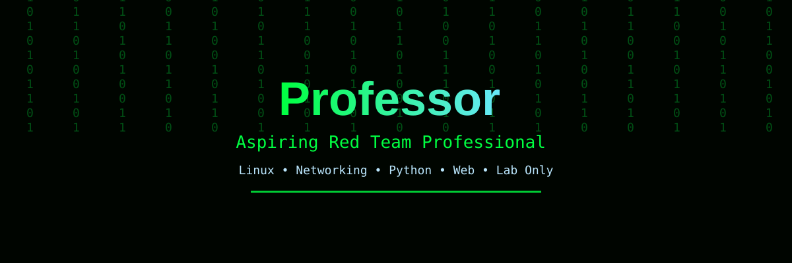

# Hi, I'm Professor 👋

### Aspiring Red Team Professional | Cybersecurity Learner

## 💫 About Me:
🎯 Aspiring Red Team professional — learning step-by-step, lab only 
🐧 Linux (Kali) — basic commands, filesystem, permissions 
🌐 Networking — IP, ports, TCP/UDP, DNS, VPN basics 
🐍 Python — learning from zero, building small labs 
💻 Frontend Web Development (HTML, CSS, JavaScript) 
🛡️ Interested in ethical hacking, OWASP basics, and secure application development 
📈 Focused on labs, write-ups, and real proof — not just certificates

## 🔐 Red Team — Learning & Building:
- Linux & Networking fundamentals
- Python labs: Password Lab, Local System Audit
- Web basics & OWASP (in progress)
- Safe labs only — own machine / private lab, with written permission only

## 📂 Featured Projects:
- **Cybersecurity-RedTeam-Roadmap** — Beginner to advanced Red Team roadmap, in big structured commits: fundamentals, Linux, networks, web, tools, practice, and checklists
- **RedTeam-Project** — Password Lab and Local System Audit, built step-by-step on my own machine

## 🌐 Socials:
      

# 💻 Tech Stack:
       
# 📊 GitHub Stats:
 
 

## 🏆 GitHub Trophies

### ✍️ Random Dev Quote

### 🔝 Top Contributed Repo

---

<!-- Proudly created with GPRM ( https://gprm.itsvg.in ) -->
